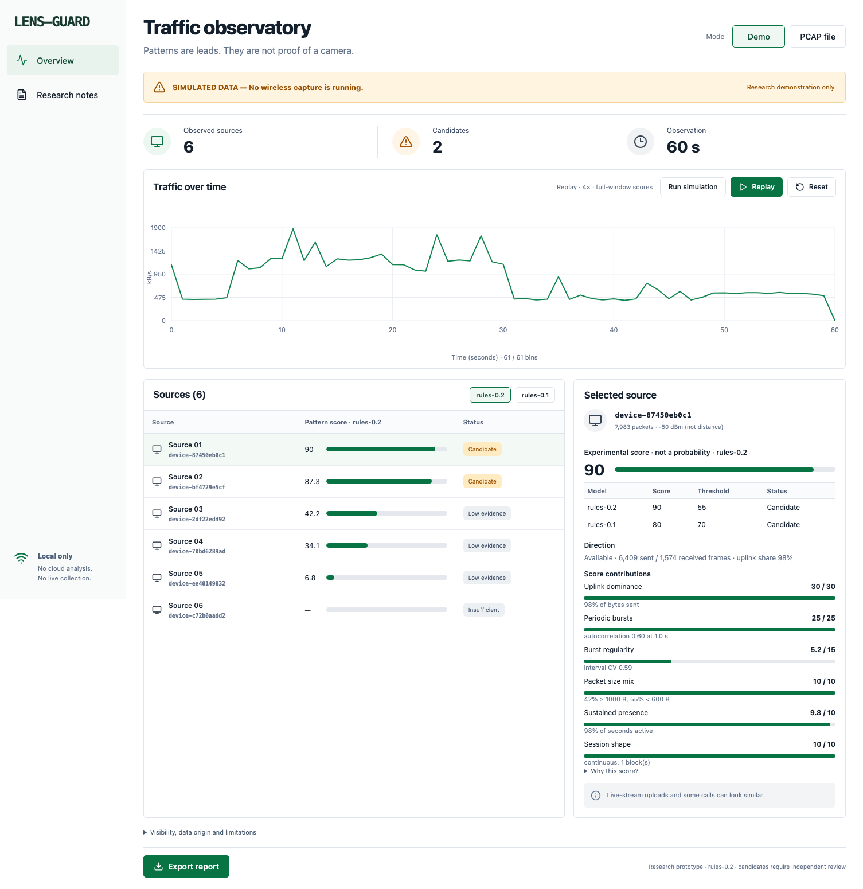

# LENS-GUARD

로컬에서 Wi-Fi 트래픽의 전송 패턴을 살펴보는 연구용 프로토타입입니다. **후보는 카메라 확정 판정이 아닙니다.** 실제 카메라 탐지 성능은 아직 검증하지 않았습니다.



## 실행

Python 3.11 이상과 Node.js 20.19 이상 또는 22.12 이상이 필요합니다. 개발 환경은 macOS 15.6.1, Apple Silicon입니다. 설치에는 인터넷이 필요하고, 설치 후 분석은 로컬에서 실행됩니다. 유료 API나 추가 장비는 필요하지 않습니다.

```sh
./scripts/start.sh
```

브라우저에서 http://127.0.0.1:8765 를 엽니다. 종료는 터미널에서 Ctrl+C를 누릅니다. 이미 설치와 빌드를 마쳤다면 다음 명령으로 바로 시작할 수 있습니다.

```sh
.venv/bin/python -m lens_guard serve
```

## 지원 기능

- **규칙 rules-0.2:** 송수신 방향을 구분해 업링크 비율, 주기적 버스트, 버스트 간격의 규칙성, 패킷 크기 구성, 지속 형태로 점수를 계산합니다. 방향 정보가 없으면 점수를 내지 않고 판단을 보류합니다. 비교용으로 rules-0.1 점수도 함께 보여 줍니다.
- **Demo:** 고정 시드로 생성한 합성 데이터, 후보 점수, 근거, 그래프 재생. Run simulation은 1초 간격으로 분석을 갱신합니다. 실제 무선 수집은 실행하지 않습니다.
- **PCAP / PCAPNG:** 본인 소유 또는 명시적으로 승인된 기기의 파일을 분석합니다. 분석할 송신 MAC 주소를 지정해야 합니다.
- **보고서:** 데이터 출처, 실험용 점수, 한계, 제외한 패킷 수를 JSON으로 내보냅니다. MAC 주소는 분석마다 달라지는 가명으로 표시합니다.
- **평가:** 9개 합성 시나리오를 개발용·잠금 테스트·분포 이동 세트로 나눠 오탐·미탐을 측정합니다. 규칙과 임계값은 테스트 전에 [사전등록](docs/PREREGISTRATION.md)했습니다. 합성 수치는 생성기 기준 동작이며 실제 탐지 성능이 아닙니다.
- **소유 기기 실측 경로:** `lens-guard evaluate-labeled --manifest <파일>`이 사용자가 라벨을 붙인 수집 파일의 지표를 계산합니다. 수집은 사용자가 [절차](docs/OWNED_DEVICE_PROTOCOL.ko.md)에 따라 직접 실행합니다. 실데이터로는 아직 검증하지 않았습니다.

화면은 영어이며, 사용·개발 문서는 한국어와 영어로 제공합니다. 그래프의 Replay는 완료된 분석을 4배속으로 재생합니다. 실시간 무선 수집이나 지속적인 실측 감시는 구현하지 않았습니다.

## Public web demo (Vercel)

The public website is **static and synthetic only**. During deployment, `scripts/export_public_demo.py` generates `web/public/demo.json` using the real Python rules engine and copies the committed evaluation to `web/public/evaluation.json`. The public React UI reads those snapshots. A public deployment does not expose a PCAP upload or analysis endpoint; PCAP processing remains **local-only** at `http://127.0.0.1:8765`.

Vercel uses the root `vercel.json` to install dependencies from `web/`, build the snapshot and dashboard, and publish `web/dist`. The public demo displays fixed full-window scores, so continuous live simulation is not offered remotely. No real captures are uploaded or stored. This is not a real-world device detection service.

## PCAP 분석 예제

합성 파일을 직접 만든 뒤 같은 분석 경로를 시험할 수 있습니다.

```sh
.venv/bin/python -m lens_guard fixture work/synthetic.pcap
.venv/bin/python -m lens_guard analyze work/synthetic.pcap \
  --allow-mac 02:00:00:00:00:01 --authorized \
  --source synthetic_file --output work/report.json
```

실제 승인된 파일은 `--source user_declared_authorized_capture`를 사용합니다. 이 표시는 사용자의 출처 진술이며, 프로그램이 실측 여부를 인증하지는 않습니다. `--allow-mac`은 여러 번 지정할 수 있습니다. 웹 화면에서는 쉼표로 구분합니다.

지원 형식은 Ethernet, 802.11, Radiotap이며 파일은 최대 32 MiB입니다. Ethernet 파일에서는 주변 Wi-Fi 기기 전체를 볼 수 없습니다. Ethernet은 송신·수신 MAC으로, 802.11은 송신자(TA)·수신자(RA) 주소로 방향을 정합니다. 상세 기준은 [분석 구조](docs/ARCHITECTURE.md)를 참고하세요.

## 검증 명령

```sh
.venv/bin/python -m pytest -q
.venv/bin/python -m lens_guard evaluate --output docs/evaluation.json
cd web
npm ci
npm run build
npx playwright install chromium
npm run test:e2e
```

[개발 결과 보고서](docs/DELIVERY.ko.md) · [평가 설계와 결과](docs/EXPERIMENTS.md) · [사전등록](docs/PREREGISTRATION.md) · [소유 기기 실측 절차](docs/OWNED_DEVICE_PROTOCOL.ko.md) · [검증 기록](docs/VALIDATION.md) · [합성 평가 결과](docs/evaluation.json) · [연구와 공개 코드 조사](docs/RESEARCH.md) · [Mac 하드웨어 검증](docs/MACOS.md)

## 범위와 한계

통신 내용 복호화, 인증 우회, 능동 스캔, 위치 추정, 불법성 판단은 구현하지 않습니다. 라이브 방송 송출은 카메라와 같은 형태라 후보로 표시됩니다. 합성 분포 이동 세트에서는 발표자 모드 영상통화와 1초 간격 센서도 후보가 됐고, 움직임이 큰 카메라 일부를 놓쳤습니다. 유선·셀룰러·전송하지 않는 카메라는 범위 밖입니다. 후보가 없다는 결과는 안전을 보장하지 않습니다.

실측 데이터는 저장소에 포함하지 않습니다. 원본 파일을 서버에 저장하거나 외부 서비스로 보내지 않습니다. 외부 연구 링크를 직접 열면 해당 사이트로 이동합니다. 실제 네트워크 수집은 별도 승인 범위와 로컬 하드웨어 검증이 필요합니다.

이 구현은 SCamF나 Lumos의 재현물이 아닙니다. 두 연구를 참고한 독립적인 규칙 기반 기준선입니다.
